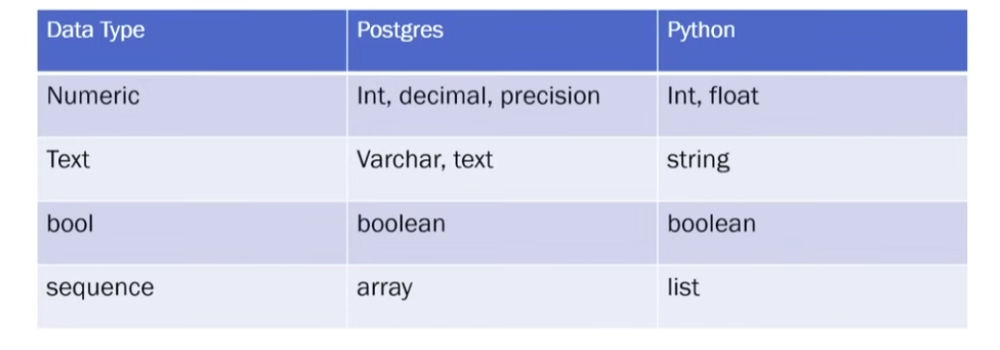
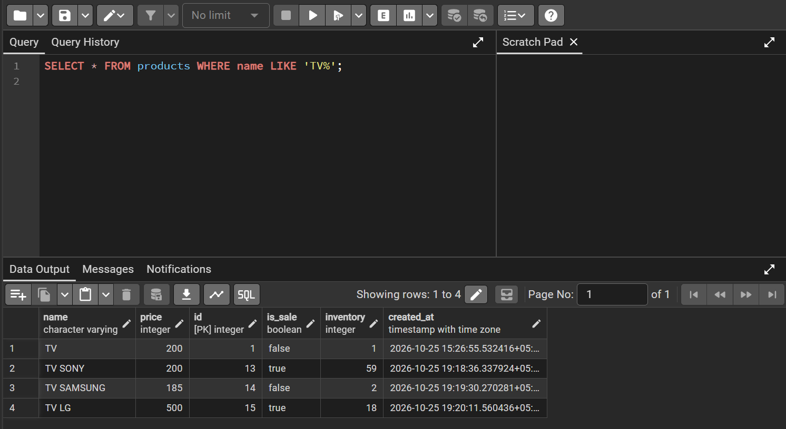

# DataBase Theory

> **Database**: A collection of data that can be easily accessed and managed.

> We operate on a database using a database management system.
> SQL stands for Structured Query Language

<!-- Relational Databases -->
- MySQL
- PostgresSQL
- Oracle
- SQL server

##### We will Primalrarily be working with PostgresSQL
---
## PostgresSQL Database
- Each instance of postgres can be carved into multiple seperate databases.
- By default every Postgres installation comes with one database already called "postgres"
- This is important as postgres requires you to specify the name of a database to make a connection.

---
## Tables
> A table represents a subject/event in an application.
> The tables created in this will be having a simple and obvious relationship hence the name, relational database.
### Columns vs Rows
- Each column represents a different attribute.
- Each row represents a new data entry in the table.
- Postgres Datatypes:
    - 

### Primary Key
> Whenever we create a table we need to define a primary key that uniquely identifies every data entry made in the table, i.e it uniquely identifies each row in a table. A table can have one and only one primary key.
---
### UNIQUE CONSTRAINTS
> **UNIQUE** constraint can be added to a column to make sure that every data entry for that particular attribute is unique.
---
### NULL CONSTRAINTS
> By default when adding a new entry to a database, any column can be left blank. When column is left blank it has **null** value.

> If we want the column to have a value we can use the **NOT NULL CONSTRAINT**, which make sures that the entry value is **not null**.
---
## SQL COMMANDS
> Capitilization is not necessary but we do it cuz it best practice and sperates SQL keywords from user input
---
- ### Data Query Language (DQL)
    - > SELECT column1, column2 FROM table_name; (Gives Table info consisting only those two columns)
    - > SELECT * FROM table_name; (Gives all the attributes of those tables)
    - 
    - 
---
- ### Data Manipulation Language (DQL)
    - > INSERT INTO table_name (column1, column2) VALUES (value1, value2), (value3, value4)     RETURNING column1; (Adds data to column1 and column2, RETURNING returns the entered data in column1)
    - > UPDATE table_name SET column1 = new_value1, column2 = new_value2 WHERE condition; (Modifies data and then returns)
    - > DELETE FROM table_name WHERE condition; (Deletes the row satisfying the given condition)
---
- ### Data Definition Language (DDL)
    - > CREATE TABLE table_name (id SERIAL PRIMARY KEY, username VARCHAR(50) NOT NULL UNIQUE,created_at TIMESTAMP DEFAULT CURRENT_TIMESTAMP); (Creates a table)
    - > -- Add a column
    - > ALTER TABLE table_name ADD COLUMN new_column VARCHAR(100);
    - > -- Drop a column
    - > ALTER TABLE table_name DROP COLUMN column_name;
    - > DROP TABLE IF EXISTS table_name CASCADE; (Deletes an entire table, database, or schema permanently)
    - > TRUNCATE TABLE table_name RESTART IDENTITY CASCADE; (Quickly removes all rows from a table without scanning individual rows (faster than DELETE).)
---